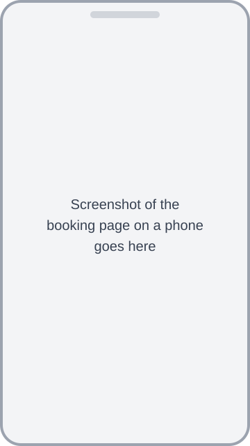

# slot-booker

Online booking for your club's events: members pick a time on their phone with no account, you manage it all from a simple admin page, and it is built to run on Cloudflare's free plan.

<!--
Maintainer: replace docs/images/booking-page-placeholder.svg with a real screenshot of the booking page on a phone
(then update the image line above, keeping the alt text meaningful).
-->

You get your own copy of the app in your own Cloudflare account, on Cloudflare's free plan. Press the button, answer a short form, then make your admin sign-in. Allow about 15 minutes.

## What the form asks for

Press the button and sign in to Cloudflare (a free account is enough). Cloudflare then asks for these, in this order:

1. **Your Git account.** Connect GitHub or GitLab. Cloudflare copies the code into it. There is a switch for whether your copy is private.
2. **A project (Worker) name.** The suggested name is fine. It becomes part of your site's address.
3. **A new database.** Cloudflare creates it for you. The suggested name is fine.
4. **`SETUP_CODE`.** A private phrase you choose, **at least 12 characters**, such as four unrelated words. You type it once, on your new site, to make your admin sign-in. Keep it private and write it down somewhere safe.
5. **Two switches: leave both OFF.**
   - **Protect with Cloudflare Access: OFF.** The app has its own admin sign-in, and Access needs a custom domain and extra set-up first ([sign-in options](docs/sign-in.md)).
   - **Enable Preview builds: OFF.** This app has no preview copies on purpose: they would put the whole app, admin pages included, on extra web addresses.
6. **Advanced settings.** Leave them as they are.

Then press **Deploy** and wait for it to finish.

If Cloudflare says your GitHub authorisation has expired, reinstall the Cloudflare GitHub app: [Cloudflare's instructions](https://developers.cloudflare.com/workers/ci-cd/builds/git-integration/github-integration/#reinstall-the-cloudflare-github-app).

## First run: `/setup`

Do this once the deploy has finished. A new site has no admin sign-in until you do.

1. Open `https://<worker-name>.<your-workers-subdomain>.workers.dev/setup`. Find the address on the Worker's page in the Cloudflare dashboard.
2. Type your `SETUP_CODE` and press **Continue**.
3. The page shows your **admin secret** once. Copy it into a password manager now. Nobody can look it up for you later.
4. Tick **I've saved it**, then press **Go to sign in**.
5. Paste the secret into **Admin secret** and press **Sign in**.

Until you first sign in, running `/setup` again replaces the secret. After your first sign-in, `/setup` is closed for good. If the secret is lost, see [If the admin secret is lost](docs/handover.md#if-the-admin-secret-is-lost). If `/setup` says "Setup isn't ready", see [Troubleshooting](docs/deploying.md#troubleshooting).

Now set your club name and privacy contact, and make your first event: the [admin guide](docs/admin-guide.md) shows you how, step by step.

## What it does

- **Booking:** a booker opens your link, picks a free time and fills in the form. They get a confirmation and an "Add to calendar" file. Bookers can't change or cancel online; they contact you, and you move or clear the booking.
- **Lanes and places:** an event has one or more lanes, such as rings or courts, and one or more places in each lane at each time.
- **Your own booking form:** ask for one to four things, such as Dog and Handler, or Name and Member number. You choose the labels and which are optional.
- **Who counts as one booker:** you mark which fields say who is booking, and how many bookings one of them may make. For example, one dog and handler may book once.
- **Events and templates:** set the date, times, session length, gap, cost, postcode, details and breaks. Save a template to reuse the same settings, including the form and lanes.
- **Sharing:** a Share button that opens the phone's share sheet (WhatsApp, for example), and a plain-text lineup of who is booked when, to paste into a chat.
- **Fixing things:** add, move, swap or clear a booking. If an edit would leave bookings with no place, you are shown who is affected before anything is removed.
- **Keeping records:** a CSV of each event's bookings, and archive or delete old events.
- **Your club's look:** club name, logo and colours, set in the admin pages.
- **Private:** no tracking, no analytics, no third-party scripts.

## Use cases

Each example is a template you could save. The labels are only suggestions. "Identifies" means the field says who is booking. The limit is how many bookings that person may make in one event.

**Dog sports trial.** Template "Saturday trial": 30-minute sessions, 5-minute gap, lanes "Ring 1" and "Ring 2", 1 place per lane per time. Fields: Dog (required, identifies), Handler (required, identifies), Phone (optional). Limit 1. A booker taps a time, taps a ring, then types the dog's and handler's names.

**Riding lessons.** Template "Lesson day": 30-minute sessions, 10-minute gap, lanes "Indoor school" and "Outdoor arena", 1 place per lane per time. Fields: Rider (required, identifies), Pony (required, identifies), Phone (optional). Limit 2. A booker picks a time and an arena, then enters the rider and pony, and can book a second lesson.

**Tennis or padel courts.** Template "Evening courts": 60-minute sessions, no gap, lanes "Court 1" to "Court 4", 1 place per lane per time. Fields: Member name (required, identifies), Member number (required). Limit 3. A booker sees each hour with a button for every court that is still free.

**Golf tee times.** Template "Saturday tee sheet": 10-minute sessions, no gap, lanes "1st tee" and "10th tee", 1 place per lane per time. Fields: Player 1 (required, identifies), Players 2, 3 and 4 (optional). Limit 1. A booker picks a tee time and enters their group; only Player 1 is needed.

**Parents' evening.** Template "Parents' evening": 10-minute appointments, no gap, one lane for each teacher ("Mrs Patel", "Mr Jones", "Ms Okafor"), 1 place per lane per time. Fields: Parent (required, identifies), Child (required, identifies), Class (optional). Limit 3. A parent picks a time with each teacher, up to three appointments.

Every lane needs a name once there are two or more. The most you can have is 10 lanes, 50 places per lane per time, 4 form fields and a limit of 20. The first field is always required, and so is every field that identifies a booking. More examples and every setting: [the admin guide](docs/admin-guide.md#the-booking-form).

## More guides

- [Admin guide](docs/admin-guide.md): how organisers use the admin pages, day to day.
- [Deploying](docs/deploying.md): the button step by step, deploying from the command line, [updating your copy](docs/deploying.md#updating-your-copy) and troubleshooting.
- [Handover](docs/handover.md): handing a site to a club's own Cloudflare account, what to keep safe, and what to do if the admin secret is lost.
- [Sign-in options](docs/sign-in.md): the shared admin secret, or Cloudflare Access on a custom domain.
- [Admin sign-in details](docs/admin-auth.md): settings, security and limits of the sign-in.
- [Club settings, logo and theme](docs/branding.md): what the settings page does.
- [Configuration](docs/configuration.md): the booking cut-off time and the privacy notice.
- [What it costs](docs/costs.md): the free plan's limits.
- [Link previews](docs/link-previews.md): what shows when a link is pasted into WhatsApp.
- [Known limits](docs/known-limits.md): what the app does not do.
- [Development](docs/development.md): running it on your own computer, tests and the phone layout check.

## Status

Work in progress. The button has been run end to end once, against the public copy of this repository (6 October 2026): it created the database, ran all the database updates that existed then, deployed the site to `workers.dev`, and `/setup`, sign-in, creating an event and booking all worked. That was one run. Anything it did not cover is marked **unverified** in the guides.

## Licence

MIT. See [LICENSE](LICENSE). Copyright (c) 2026 Aerie Technology.
