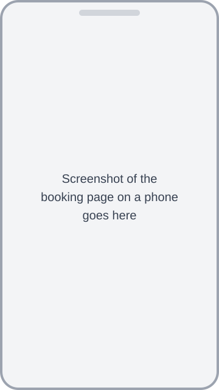

# slot-booker

Online booking for your club's events: members pick a time on their phone with no account, you manage it all from a simple admin page, and it is built to run on Cloudflare's free plan.

<!--
Maintainer: replace docs/images/booking-page-placeholder.svg with a real screenshot of the booking page on a phone
(then update the image line above, keeping the alt text meaningful).
-->

You get your own copy of the app in your own Cloudflare account, on Cloudflare's free plan. Press the button, answer a short form, then open your new site to make your admin sign-in. There is no password to choose on the form.

## What the form asks for

Press the button and sign in to Cloudflare (a free account is enough). Cloudflare then asks for these, in this order:

1. **Your Git account**, and a **"Create private Git repository"** checkbox. Cloudflare copies the code into your account. Tick the box if you want your copy to be private.
2. **Project name.** The suggested name is fine. It is also your Worker's name, your copy's repository name and part of your site's address. If your account already has a repository of that name, Cloudflare suggests the same name with `-1` on the end; accept it.
3. **Database.** Leave **Create new**, and leave the suggested name, location hint and read-replication checkbox as they are.
4. **Build command** (empty) and **Deploy command** (`npm run deploy`). Leave both.
5. Cloudflare shows an **"Enable Preview builds"** switch, **on** by default (seen on 31 October 2026). Switch it **off**: it builds a public preview of any other branch you push to your copy, and this site never needs one. If a switch for Cloudflare Access appears, leave it off (not seen so far).

The sentence "Your club's booking database…" may show under **Project name** rather than beside the database fields. Ignore where it sits: there is nothing to fill in.

There is no admin secret or password field on the form (seen on 31 October 2026).

Then press **Deploy**. It takes about a minute.

If Cloudflare says your GitHub authorisation has expired, reinstall the Cloudflare GitHub app: [Cloudflare's instructions](https://developers.cloudflare.com/workers/ci-cd/builds/git-integration/github-integration/#reinstall-the-cloudflare-github-app).

## First run: `/setup`

Cloudflare does not show you your site's address when the deploy ends, so first find it.

**Find your site's address.**

1. It is the `https://….workers.dev` line near the end of the build log.
2. Or, in the Cloudflare dashboard, open **Workers & Pages**, then your Worker (it has the name you gave the project). In its **Domains** section the address is the **Worker URL** (seen on 31 October 2026). The **Production** and **Preview** toggles next to it can look switched off while the site works: leave them alone.

Open that address, not `/setup`, for your first visit. Then:

1. While the first-run window is open, the address takes you to a page that says the site has no admin yet. Press **Create my admin secret**.
2. The page shows your **admin secret** (you sign in with it) and your **recovery code** (it makes a new secret if you lose this one). Both are shown **once**. Copy **both** into a password manager, ideally as two separate entries. Nobody can look them up for you later.
3. Tick **I've saved both**, then press **Go to sign in**.
4. Paste the admin secret into **Admin secret** and press **Sign in**.

Things to know:

- **You have 30 minutes.** They count from when the database was created, not from your first visit, and a redeploy does not reopen them. A second visitor is refused ("This site has already been set up"). Until you first sign in, and within a day, the same browser can ask for a new pair, which replaces the first.
- **Until you press the button, anyone who finds your site's address could press it first.** To rule that out, set `SETUP_CODE` as a Worker secret (any phrase of 12 or more characters) before your first visit. The 30 minutes then no longer apply and `/setup` asks for that phrase.
- **After 30 minutes with no admin made,** your address just shows the ordinary home page ("No events are open for booking right now"). To see the closed message, add `/setup` to the address; it says setup is closed (opening `/admin` says sign-in isn't set up). Set `SETUP_CODE` as above and reload `/setup`. [Handover](docs/handover.md#if-the-admin-secret-is-lost) has the other ways.
- **After your first sign-in,** `/setup` is closed for good.
- **If you lose the admin secret,** use the recovery code on your site's `/recover` page. If you lose both, see [If the admin secret is lost](docs/handover.md#if-the-admin-secret-is-lost). More on problems: [Troubleshooting](docs/deploying.md#troubleshooting).

Now set your club name and privacy contact, and make your first event: the [admin guide](docs/admin-guide.md) shows you how, step by step.

## What it does

- **Booking:** a booker opens your link, picks a free time and fills in the form. They get a confirmation and an "Add to calendar" file. Bookers can't change or cancel online; they contact you, and you move or clear the booking.
- **Lanes and places:** an event has one or more lanes, such as rings or courts, and one or more places in each lane at each time.
- **Your own booking form:** ask for one to four things, such as Dog and Handler, or Name and Member number. You choose the labels and which are optional.
- **Who counts as one booker:** you mark which fields say who is booking, and how many bookings one of them may make. For example, one dog and handler may book once.
- **Events and templates:** set the date, times, session length, gap, cost, postcode, details and breaks. Save a template to reuse the same settings, including the form and lanes.
- **Sharing:** a Share button that opens the phone's share sheet (WhatsApp, for example), and a plain-text lineup of who is booked when, to paste into a chat.
- **Fixing things:** add, move, swap or clear a booking. If an edit would leave bookings with no place, you are shown who is affected before anything is removed.
- **Keeping records:** a CSV of each event's bookings, and archive or delete old events.
- **Your club's look:** club name, logo and colours, set in the admin pages.
- **Private:** no tracking, no analytics, no third-party scripts.

## Use cases

Each example is a template you could save. The labels are only suggestions. "Identifies" means the field says who is booking. The limit is how many bookings that person may make in one event.

**Dog sports trial.** Template "Saturday trial": 30-minute sessions, 5-minute gap, lanes "Ring 1" and "Ring 2", 1 place per lane per time. Fields: Dog (required, identifies), Handler (required, identifies), Phone (optional). Limit 1. A booker taps a time, taps a ring, then types the dog's and handler's names.

**Riding lessons.** Template "Lesson day": 30-minute sessions, 10-minute gap, lanes "Indoor school" and "Outdoor arena", 1 place per lane per time. Fields: Rider (required, identifies), Pony (required, identifies), Phone (optional). Limit 2. A booker picks a time and an arena, then enters the rider and pony, and can book a second lesson.

**Tennis or padel courts.** Template "Evening courts": 60-minute sessions, no gap, lanes "Court 1" to "Court 4", 1 place per lane per time. Fields: Member name (required, identifies), Member number (required). Limit 3. A booker sees each hour with a button for every court that is still free.

**Golf tee times.** Template "Saturday tee sheet": 10-minute sessions, no gap, lanes "1st tee" and "10th tee", 1 place per lane per time. Fields: Player 1 (required, identifies), Players 2, 3 and 4 (optional). Limit 1. A booker picks a tee time and enters their group; only Player 1 is needed.

**Parents' evening.** Template "Parents' evening": 10-minute appointments, no gap, one lane for each teacher ("Mrs Patel", "Mr Jones", "Ms Okafor"), 1 place per lane per time. Fields: Parent (required, identifies), Child (required, identifies), Class (optional). Limit 3. A parent picks a time with each teacher, up to three appointments.

Every lane needs a name once there are two or more. The most you can have is 10 lanes, 50 places per lane per time, 4 form fields and a limit of 20. The first field is always required, and so is every field that identifies a booking. More examples and every setting: [the admin guide](docs/admin-guide.md#the-booking-form).

## More guides

- [Admin guide](docs/admin-guide.md): how organisers use the admin pages, day to day.
- [Deploying](docs/deploying.md): the button step by step, deploying from the command line, [updating your copy](docs/deploying.md#updating-your-copy) and troubleshooting.
- [Handover](docs/handover.md): handing a site to a club's own Cloudflare account, what to keep safe, and what to do if the admin secret is lost.
- [Sign-in options](docs/sign-in.md): the shared admin secret, or Cloudflare Access on a custom domain.
- [Admin sign-in details](docs/admin-auth.md): settings, security and limits of the sign-in.
- [Club settings, logo and theme](docs/branding.md): what the settings page does.
- [Configuration](docs/configuration.md): the booking cut-off time and the privacy notice.
- [What it costs](docs/costs.md): the free plan's limits.
- [Link previews](docs/link-previews.md): what shows when a link is pasted into WhatsApp.
- [Known limits](docs/known-limits.md): what the app does not do.
- [Development](docs/development.md): running it on your own computer, tests and the phone layout check.

## Status

Work in progress. The button has been run end to end once against the public copy of this repository (6 October 2026), when it still asked for a setup code: it created the database, ran all the database updates that existed then, deployed the site to `workers.dev`, and `/setup`, sign-in, creating an event and booking all worked. On 22 October 2026 a trial copy of the earlier version with no setup code was deployed through the form (it showed no secret field), which is what the form list above is based on. On 31 October 2026 the current version was run through the button: the form had no secret field, the build took 55 seconds and applied all 19 migrations, `/` went to the first-run page, which showed the admin secret and the recovery code once on one screen, and sign-in worked. On 1 November 2026 a live copy was updated by pushing to it (Workers Builds redeployed it, and the closed first-run window stayed closed), and its owner claimed again in a reopened window and used `/recover` (a wrong code was refused; the right code gave a new admin secret and recovery code). Upgrading a v1.1 site has not been run and remains **unverified**. Anything not covered by a real run is marked **unverified** in the guides.

## Licence

MIT. See [LICENSE](LICENSE). Copyright (c) 2026 Aerie Technology.
